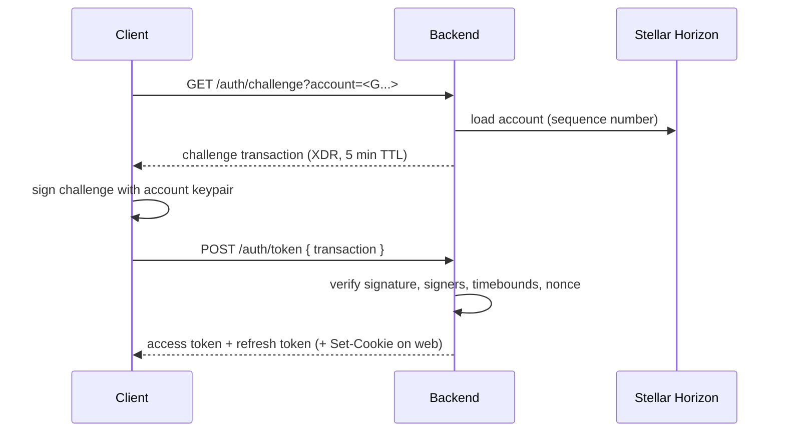
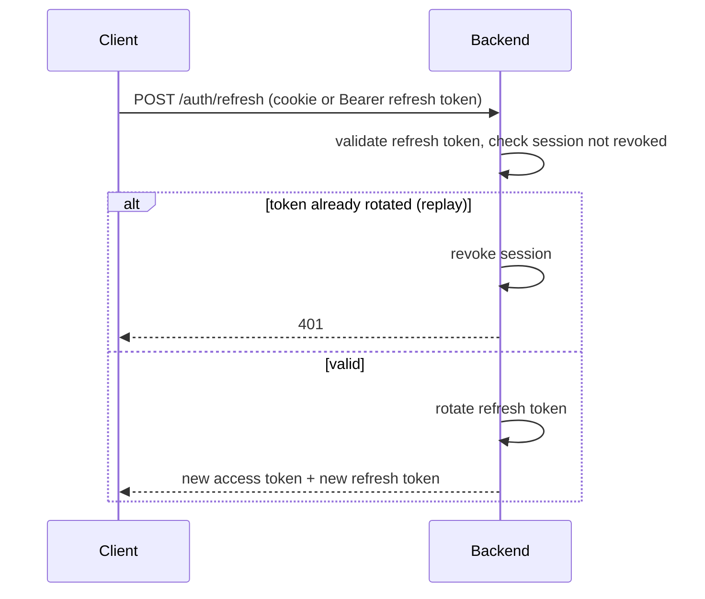
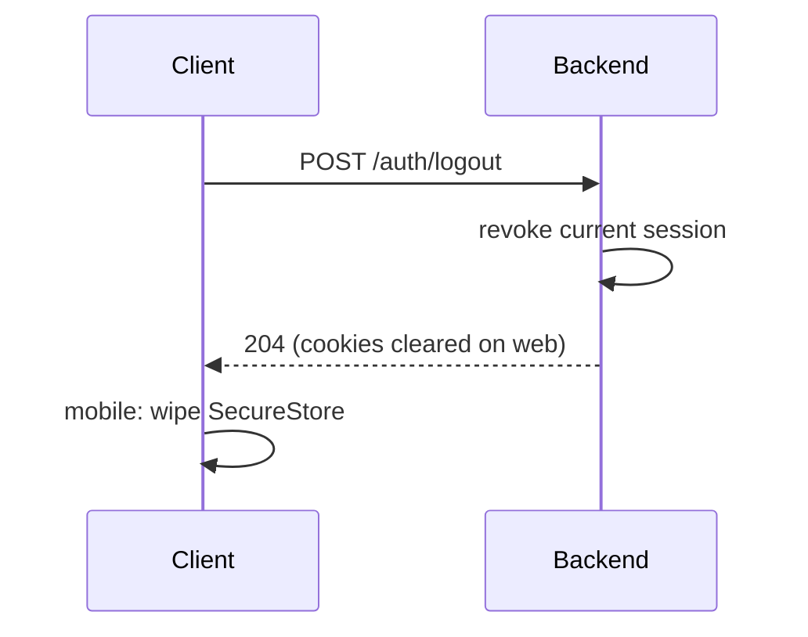

# Authentication flows — web and mobile clients

This document describes how clients authenticate against the backend API.
It is written for app developers building the web (`frontend/`) and mobile
(`mobile/`) clients, and for anyone new to the codebase or to Stellar.

Authentication uses [SEP-10 Stellar Web Authentication](https://github.com/stellar/stellar-protocol/blob/master/ecosystem/sep-0010.md):
the client proves control of a Stellar account by signing a server-issued
challenge transaction, and the server exchanges that signed challenge for a
session. The session is then presented on every subsequent request — as a
cookie on web, as a Bearer token on mobile.

> **Why this matters:** auth bugs are security bugs. The rules below on
> where tokens live, when to refresh, and how to log out are not
> suggestions — follow them exactly.

## Concepts

- **SEP-10** — the Stellar standard for web authentication. The server
  returns a challenge transaction; the client signs it with the account's
  keypair; the server verifies the signature and issues a session.
- **Access token** — short-lived credential sent on every API request.
- **Refresh token** — longer-lived credential used only to obtain a new
  access token. Never sent to resource endpoints.
- **Session** — the server-side record tying a refresh token to a device.
  Revoking a session invalidates its refresh token immediately.

## Token lifetimes

| Token         | Lifetime | Rationale |
| ------------- | -------- | --------- |
| Challenge (SEP-10) | 5 minutes | Bounds the window in which a captured challenge can be replayed. |
| Access token  | 15 minutes | Short enough that a leaked token has limited value; long enough to avoid a refresh on every request. |
| Refresh token | 30 days (sliding) | Keeps users signed in across app restarts without re-signing; rotated on every use so a stolen refresh token is single-use. |
| Session       | 30 days idle | Matches the refresh token; revoked explicitly on logout. |

Access tokens are **stateless** (signed JWTs) and are not checked against
the session store on every request — that is why they are kept short.
Refresh tokens are **stateful**: each one maps to a session row and can be
revoked. Rotate refresh tokens on every refresh; a reused (already-rotated)
refresh token is treated as replay and revokes the whole session.

## Storage rules per platform

| Concern            | Web (`frontend/`)                          | Mobile (`mobile/`)                          |
| ------------------ | ------------------------------------------ | ------------------------------------------- |
| Access token       | HttpOnly cookie, `Secure`, `SameSite=Lax`  | In-memory only (never persisted)            |
| Refresh token      | HttpOnly cookie, `Secure`, `SameSite=Strict` | `expo-secure-store` (Keychain / Keystore) |
| CSRF protection    | Double-submit CSRF token header            | Not applicable (no ambient credentials)     |
| Transport          | HTTPS only                                 | HTTPS only                                  |
| Logout             | `POST /auth/logout` clears cookies + revokes session | `POST /auth/logout` with Bearer, then wipe SecureStore |

**Web** relies on cookies per [RFC 6265](https://www.rfc-editor.org/rfc/rfc6265)
and therefore needs CSRF protection — see the
[OWASP CSRF Prevention Cheat Sheet](https://cheatsheetseries.owasp.org/cheatsheets/Cross-Site_Request_Forgery_Prevention_Cheat_Sheet.html).
Cookies are `HttpOnly` so JavaScript (and therefore XSS) cannot read them.

**Mobile** has no ambient cookie jar, so it uses `Authorization: Bearer
<access-token>` and stores the refresh token in the OS secure store. Never
write tokens to `AsyncStorage`, logs, or crash reports.

## Flows

### SEP-10 sign-in



On web the tokens arrive as `Set-Cookie` headers; on mobile they arrive in
the JSON body and the client stores the refresh token in SecureStore.

### Refresh



Refresh proactively when the access token is within ~1 minute of expiry,
and reactively on a `401` by refreshing once and retrying the request.

### Logout



### Session revoke (all devices)

```mermaid
sequenceDiagram
    participant C as Client
    participant S as Backend
    C->>S: POST /auth/sessions/revoke-all
    S->>S: revoke every session for the account
    S-->>C: 204
    C->>C: mobile: wipe SecureStore; web: cookies cleared
```

Use this after a suspected compromise or when the user changes their
signing key. Individual sessions can be revoked with
`DELETE /auth/sessions/:id`.

## References

- [SEP-10 Stellar Web Authentication](https://github.com/stellar/stellar-protocol/blob/master/ecosystem/sep-0010.md)
- [RFC 6265 — HTTP State Management Mechanism (cookies)](https://www.rfc-editor.org/rfc/rfc6265)
- [OWASP CSRF Prevention Cheat Sheet](https://cheatsheetseries.owasp.org/cheatsheets/Cross-Site_Request_Forgery_Prevention_Cheat_Sheet.html)
- [OWASP Session Management Cheat Sheet](https://cheatsheetseries.owasp.org/cheatsheets/Session_Management_Cheat_Sheet.html)
