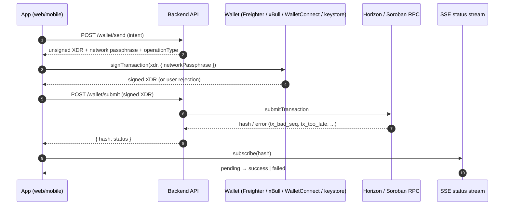
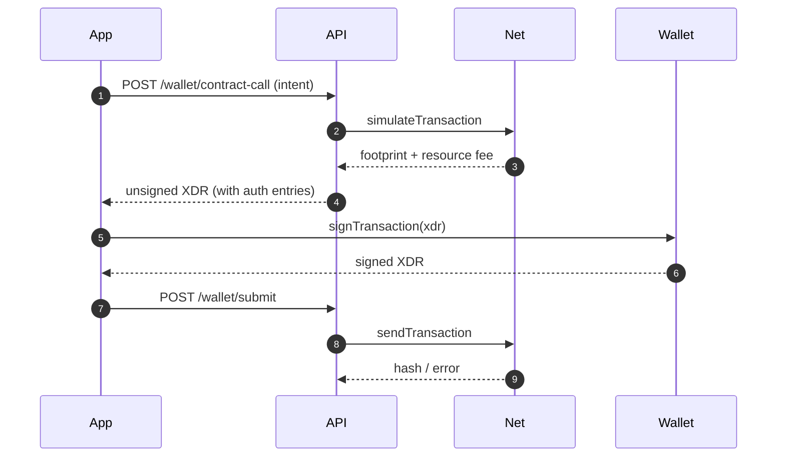

# Client-side signing sequence (web & mobile)

This document explains how a wallet client turns a user intent ("send 10 XLM
to `G...`") into a signed, submitted Stellar transaction. It is written for
frontend contributors who are new to Stellar. Read it top to bottom once; after
that use the troubleshooting table at the end.

Concepts referenced here:

- [Transactions & operations](https://developers.stellar.org/docs/learn/fundamentals/transactions/operations-and-transactions)
- [Sequence numbers](https://developers.stellar.org/docs/learn/encyclopedia/transactions-specialized/sequence-numbers)
- [Fee-bump transactions](https://developers.stellar.org/docs/learn/encyclopedia/transactions-specialized/fee-bump-transactions)
- [Soroban smart contracts](https://developers.stellar.org/docs/build/smart-contracts/overview)
- [Stellar Wallets Kit](https://stellarwalletskit.dev/)
- [Horizon API reference](https://developers.stellar.org/docs/data/apis/horizon/api-reference)
- [MDN Server-sent events](https://developer.mozilla.org/en-US/docs/Web/API/Server-sent_events)

## The flow at a glance



Key rules:

1. **The client never builds the transaction itself.** The API returns an
   unsigned XDR built against the current sequence number and fee. Signing is
   the only step the client owns.
2. **The client never submits directly to Horizon.** Submit through the API so
   the indexer and SSE stream see the transaction.
3. **The signed XDR is single-use.** If submission fails with a retryable error,
   ask the API to rebuild — do not re-submit the same XDR.

## Signing with Freighter (web)

```ts
import { signTransaction, isConnected } from '@stellar/freighter-api';

// 1. Ask the API to build the transaction.
const build = await fetch('/api/v1/wallet/send', {
  method: 'POST',
  headers: { 'content-type': 'application/json', authorization: `Bearer ${jwt}` },
  body: JSON.stringify({ sourcePublicKey, destinationPublicKey, amount, asset, memo }),
}).then((r) => r.json());

// 2. Sign with the wallet. The passphrase must match the network the API used.
if (!(await isConnected()).isConnected) throw new Error('Freighter not installed');
const { signedTxXdr, error } = await signTransaction(build.xdr, {
  networkPassphrase: build.networkPassphrase,
});
if (error) throw new Error(error); // user rejected or wallet error

// 3. Submit through the API.
const result = await fetch('/api/v1/wallet/submit', {
  method: 'POST',
  headers: { 'content-type': 'application/json', authorization: `Bearer ${jwt}` },
  body: JSON.stringify({ signedXdr: signedTxXdr }),
}).then((r) => r.json());
```

## Signing with Stellar Wallets Kit (web, multi-wallet)

Stellar Wallets Kit wraps Freighter, xBull, WalletConnect and others behind one
API. Use it when you want the user to pick a wallet.

```ts
import { StellarWalletsKit, WalletNetwork, allowAllModules } from '@creit.tech/stellar-wallets-kit';

StellarWalletsKit.init({ network: WalletNetwork.TESTNET, modules: allowAllModules() });

// Let the user choose a wallet (renders the kit's modal).
await StellarWalletsKit.authModal();

// Sign the XDR returned by the API.
const { signedTxXdr } = await StellarWalletsKit.signTransaction(build.xdr, {
  networkPassphrase: build.networkPassphrase,
  address: sourcePublicKey,
});
```

- **xBull** is included in `allowAllModules()`; no extra setup.
- **WalletConnect** requires a project ID from
  [WalletConnect Cloud](https://cloud.walletconnect.com/) and is the recommended
  path for mobile browsers and native mobile apps (see below).

## Signing with a local Keypair (tests only)

Never ship a secret key in a client. Use this only in unit/integration tests.

```ts
import { Keypair, TransactionBuilder, Networks } from '@stellar/stellar-sdk';

const kp = Keypair.fromSecret(process.env.TEST_SECRET!);
const tx = TransactionBuilder.fromXDR(build.xdr, build.networkPassphrase);
tx.sign(kp);
const signedXdr = tx.toXDR();
```

## Mobile: WalletConnect vs local keystore

| | WalletConnect | Local keystore |
| --- | --- | --- |
| Key custody | User's external wallet app | App (device secure storage) |
| UX | Deep-link to wallet, approve, return | In-app biometric prompt |
| Setup | WalletConnect project ID + relay | Keychain / Keystore integration |
| Risk | Depends on wallet app | App compromise = key compromise |
| Recommended for | Most users | Power users / custodial flows |

Both paths produce the same signed XDR and submit through the API. The only
difference is where the private key lives.

## Soroban: auth entries, simulation and rebuilds

Soroban contract invocations differ from classic payments:

1. **Simulation first.** The API simulates the invocation to discover the
   required footprint (ledger keys) and the resource fee. The unsigned XDR it
   returns already includes the simulated footprint and fee.
2. **Auth entries.** If the contract call requires authorization, the XDR
   contains `SorobanAuthorizationEntry` values. The wallet signs these as part
   of `signTransaction`; the client must not strip or reorder them.
3. **Why a rebuild may be needed.** Simulation results are only valid for a
   short window (the current ledger plus a few). If the user takes too long to
   sign, or the footprint's ledger entries change, submission fails with
   `tx_too_late` or a footprint error. In that case call the build endpoint
   again — do **not** re-sign the stale XDR.



## Troubleshooting

| Error | Meaning | What to do |
| --- | --- | --- |
| `tx_bad_seq` | The source account's sequence number changed (another tx landed first). | Rebuild the transaction via the API to pick up the new sequence, then re-sign. Never retry the same XDR. |
| `tx_too_late` | The transaction's `timebounds.maxTime` has passed. | Rebuild with fresh timebounds and re-sign. For Soroban, also re-simulate. |
| `tx_insufficient_fee` | The fee is below the current network minimum. | Rebuild to get the current fee, or submit a [fee-bump](https://developers.stellar.org/docs/learn/encyclopedia/transactions-specialized/fee-bump-transactions) transaction. |
| `op_no_trust` | The destination account has no trustline for the asset. | Ask the user to add a trustline, or send XLM instead. The precheck endpoint reports this as `NO_TRUSTLINE`. |
| `PATH_EXPIRED` | A path-payment offer used in the path has expired. | Rebuild the path payment to get fresh offers and re-sign. |

### Retry policy

- `tx_bad_seq`, `tx_too_late`, `tx_insufficient_fee`, `PATH_EXPIRED` are
  **retryable after a rebuild**. Rebuild → re-sign → resubmit, at most 3 times.
- `op_no_trust` and other `op_*` errors are **not retryable** without user
  action; surface the message and stop.
- A user rejection from the wallet is not an error to retry — return to the
  review screen.
