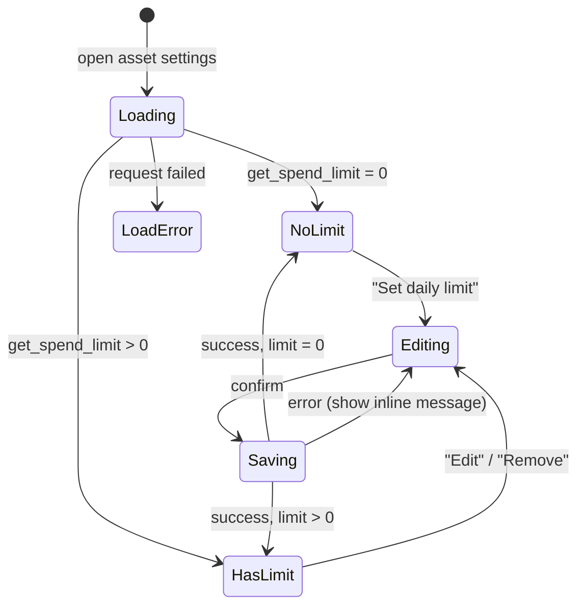

# Spend Limits — UX Spec

How users set a daily spend limit per asset, what they see when a send would
exceed it, and when it resets. This is a behaviour spec for the web and mobile
apps; it does not define visuals (see the design file linked from the README).

Source of truth: `set_spend_limit`, `get_spend_limit` and `record_spend` in
[`contract/contracts/globe-wallet/src/lib.rs`](../../contract/contracts/globe-wallet/src/lib.rs).
New to Soroban? Start with the
[smart contracts overview](https://developers.stellar.org/docs/build/smart-contracts/overview).

## Contract behaviour the UI must respect

| Rule | Contract detail |
|---|---|
| Limits are **per asset** | Keyed by `(user, asset_code)`; XLM and USDC limits are independent. |
| Amounts are in the **smallest unit** | `i128` stroops (1 XLM = 10,000,000). The UI converts to and from display units. |
| `0` means **no limit** | `get_spend_limit` returns `0` when unset; setting `0` removes the limit. |
| Day window is **UTC** | `day = ledger_timestamp / 86400`, so it resets at 00:00 UTC, not local midnight. |
| Lowering is **retroactive** | `set_spend_limit` fails with `SpendLimitExceeded` if today's spend is already above the new limit. |
| A spend is checked **before** fees | `record_spend` is simulated first, so a blocked send costs nothing. |

## Set / edit a limit

- **Loading:** skeleton for the limit and "remaining today" rows.
- **No limit (empty):** "No daily limit on {asset}." with a "Set daily limit" action.
- **Has limit:** limit, amount remaining today, and reset time (below).
- **Editing:** numeric input in display units, asset code shown beside it.
  Validate before submitting: must be a number ≥ 0 with no more than the
  asset's decimals (7 for Stellar assets). "Remove limit" submits `0`.
- **Load error:** "Couldn't load your limit." with Retry; do not show `0`,
  which would wrongly read as "no limit".

## Remaining and reset display

- Remaining today = limit − spent today, floored at 0. Read it from
  `GET /api/v1/contract/wallet/{publicKey}/spend-allowance` (all whitelisted
  assets) or `.../spend-allowance/{assetCode}` (one asset), which return
  `limit`, `spent`, `remaining` and `windowResetsAt` straight from the
  contract's `get_spend_allowance` view. It is a simulated read, up to one
  ledger behind; the `record_spend` check is still authoritative.
- `unlimited: true` means no limit is set; `remaining` is then `null` and
  `spent` is always `"0"` because the contract does not track spends for
  assets without a limit.
- Window boundaries use **ledger close time**, not server or device clocks:
  `day = ledger_timestamp / 86400`, so `windowStartsAt` and `windowResetsAt`
  are always 00:00:00 UTC exactly. The first spend after `windowResetsAt` is
  counted in the new window once a ledger with a later timestamp closes.
  Ledger timestamps can trail wall-clock time by a few seconds, so near
  midnight a send may still count against the old window.
- Reset time: `windowResetsAt` **converted to the device's time zone**, e.g.
  "Resets at 1:00 AM (00:00 UTC)". Always show the UTC time alongside, since
  users east or west of UTC will see the reset mid-day.

## Send blocked by a limit

The send flow calls `POST /api/v1/contract/wallet/spend` before submitting the
payment. Errors arrive in the standard error shape.

| API response | Contract error | UI state and copy |
|---|---|---|
| `422 SOROBAN_SIMULATION_FAILED`, message contains `SpendLimitExceeded (contract error #1007)` | `SpendLimitExceeded` | Block the send. "This would go over your daily {asset} limit. You can send up to {remaining} more today, or wait until {reset time}." Actions: "Send {remaining}" (if > 0), "Change limit". |
| `422`, `InvalidSpendLimit (#1006)` | amount ≤ 0 | Should not reach the API; client-side "Enter an amount greater than 0". |
| `422`, `SpendOverflow (#10)` | sum overflowed `i128` | "That amount is too large." |
| `502 SOROBAN_TX_FAILED` | submission failed | "The network rejected the transaction. Nothing was sent." with Retry; show the `hash` under "Details". |

When saving a lower limit fails with `SpendLimitExceeded`, the copy is
different: "You've already sent {spent} {asset} today, more than this limit.
Choose at least {spent}, or set it after {reset time}."

## Worked example

A user in Lagos (UTC+1) has a 100 XLM daily limit (`1000000000` stroops).

| Local time | Action | Result | Remaining shown |
|---|---|---|---|
| 09:00 | Send 60 XLM | Allowed | 40 XLM, "Resets at 1:00 AM (00:00 UTC)" |
| 14:00 | Send 50 XLM | `SpendLimitExceeded`; offer "Send 40 XLM" | 40 XLM |
| 15:00 | Lower limit to 50 XLM | `SpendLimitExceeded` (60 already sent) | 40 XLM |
| 01:05 next day | Send 50 XLM | Allowed — new UTC day | 50 XLM |

## Partial failure

If the limit check passes but the payment itself then fails, the spend is
already recorded for today. Show "Payment failed — your daily allowance was
still used" so the remaining amount does not surprise the user.

## API dependencies

- `POST /api/v1/contract/wallet/spend` — the limit check before a send.
- `GET /api/v1/contract/wallet/{publicKey}/spend-allowance[/{assetCode}]` —
  limit, spent, remaining and window bounds (issue #50).

Still missing: an endpoint wrapping `set_spend_limit` (unsigned-XDR builder,
issue #7).
